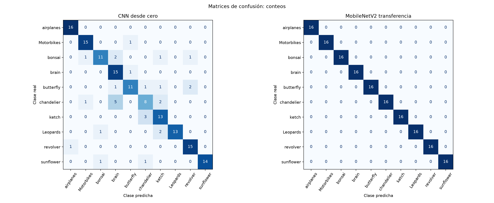

Clasificación de diez categorías de [Caltech 101](https://data.caltech.edu/records/mzrjq-6wc02) con una CNN básica entrenada desde cero y MobileNetV2 preentrenada en ImageNet, adaptada mediante transferencia de aprendizaje y ajuste fino.

[Abrir el notebook en Google Colab](https://colab.research.google.com/github/Aldous6/IA/blob/main/caltech101_colab/Caltech101_10_clases.ipynb). El archivo conserva la ejecución completa en CPU, las explicaciones, las curvas de aprendizaje y las matrices de confusión de ambas redes. No necesitas volver a entrenar para consultar sus resultados. Para repetir el experimento, selecciona **Entorno de ejecución → Ejecutar todas**; la primera ejecución descarga las imágenes y los pesos necesarios.

Se eligieron las clases `airplanes`, `Motorbikes`, `bonsai`, `brain`, `butterfly`, `chandelier`, `ketch`, `Leopards`, `revolver` y `sunflower`. Se utilizaron 80 imágenes únicas por clase, con semilla 42: 480 para entrenamiento, 160 para validación y 160 para prueba. Ambas redes usaron las mismas particiones; el conjunto de prueba se reservó para la evaluación final.

La CNN acertó 131 de 160 imágenes de prueba, con exactitud de 81.88 % y F1 macro de 0.8172. MobileNetV2 acertó 160 de 160, con exactitud de 100 % y F1 macro de 1.0000. Estas cifras corresponden a esta selección y partición; no garantizan el mismo desempeño en otras imágenes. La comparación utiliza arquitecturas distintas y no aísla el efecto del preentrenamiento.

La carpeta `resultados/` contiene las matrices y reportes en CSV, las gráficas PNG, el manifiesto de particiones, las predicciones, las conclusiones y los dos modelos completos en formato `.keras`. `configuracion.json` registra las versiones utilizadas y el orden de las clases. Los modelos reciben imágenes RGB de 128 × 128 píxeles con valores entre 0 y 255 e incluyen su normalización.

Para ejecutar localmente con Python 3.12, instala las dependencias con `python -m pip install -r requirements.txt` y ejecuta `python ejecutar_notebook.py`. Este último comando vuelve a entrenar y guarda las salidas en el notebook. `crear_notebook.py` regenera el documento sin resultados y `preparar_datos.py` permite descargar y verificar el archivo original por separado. No se incluyen el dataset, los checkpoints intermedios ni las cachés; el notebook los genera al ejecutarse. Las rutas personales de las salidas publicadas se sustituyeron por rutas relativas.
